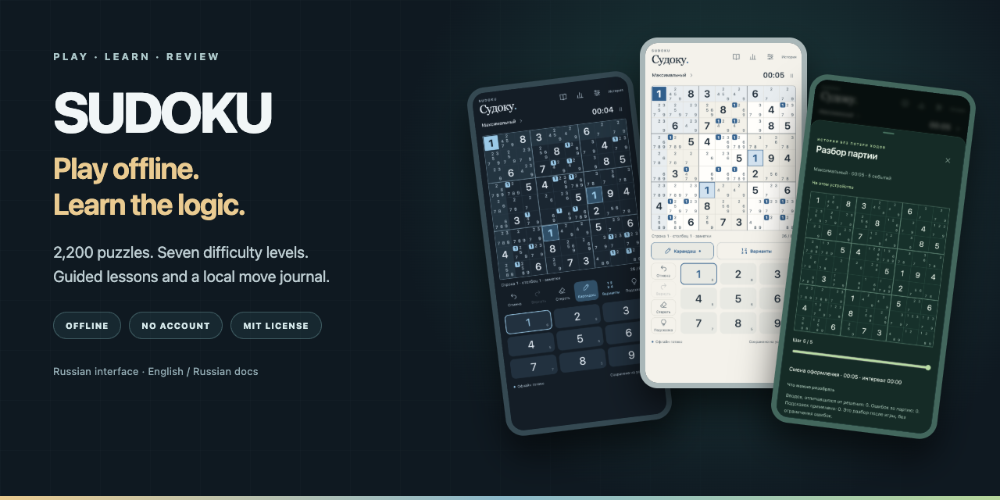
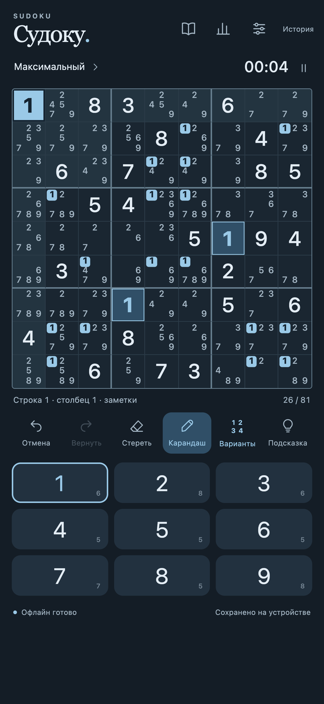
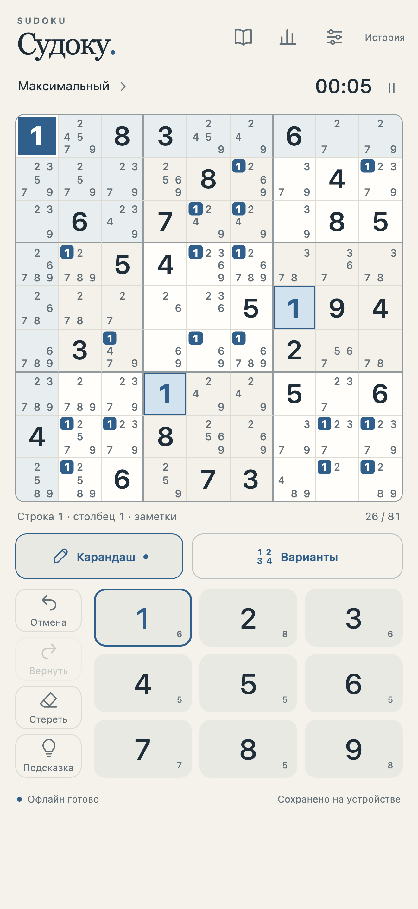
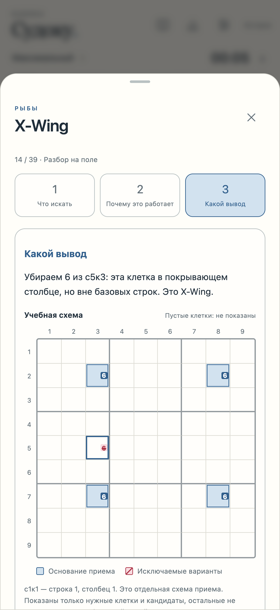
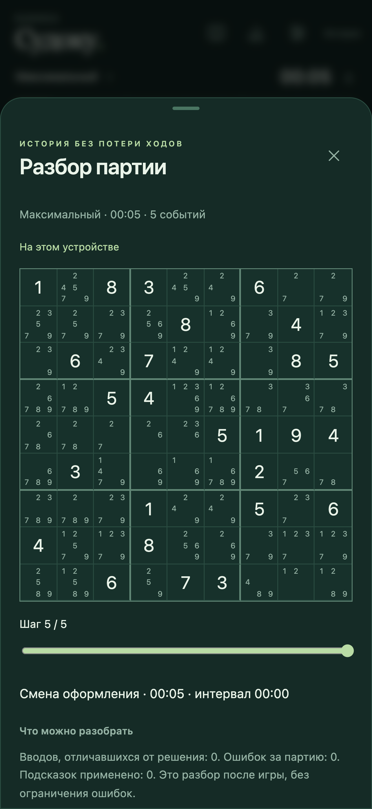

# Sudoku PWA

[English](README.md) · [Русский](README.ru.md)



[Start locally](#start-locally) · [Screenshots](#screenshots) · [How puzzles work](#how-additional-puzzles-are-checked)

A standalone, offline-capable Sudoku game with guided lessons and a local move journal. Public release **0.1.0**. The interface is currently **Russian**; the documentation is available in English and Russian.

## Features

- Seven difficulty levels and 2,200 generated puzzles; the test suite independently checks that every catalog puzzle has exactly one solution.
- Pencil marks, candidates, hints, undo/redo, pause, active-play timing, themes and statistics. Mistakes do not end a game.
- 39 lessons with diagrams, quizzes and practice positions.
- Local autosave, a move-by-move replay and user-triggered JSON export of a game journal.
- A service worker prepares the application for offline use after the first successful load.

This public edition was extracted from an existing application. Its standalone work removes the account/server integration, uses a separate local storage namespace and adds a static-only preview server. It contains no account service or cloud synchronization.

## Start locally

Requirements: Python 3.10+ for the preview server and a current browser with JavaScript, localStorage, IndexedDB and service-worker support. Node.js 20+ is needed only for tests. No npm dependencies or build step are required.

1. Download the repository ZIP and unpack it.
2. Open a terminal in the unpacked folder and run:

```sh
python3 scripts/serve.py
```

3. Open <http://127.0.0.1:8767/> in the browser. Wait for **Офлайн готово** before testing an offline reload. Stop the server with Ctrl+C.

To choose another port, use `python3 scripts/serve.py --port 8768` and open that port instead. The server binds only to loopback and serves only `dist/`. Opening `index.html` as a file does not provide the supported module/offline environment.

For another device, publish the contents of `dist/` to your own HTTPS static host. A phone cannot reach the computer through its own loopback address. This repository does not configure hosting or enable GitHub Pages automatically. Home-screen installation and physical-device behavior require testing on the target device.

## How additional puzzles are checked

The 2,200 entries are a verified starting catalog. The lower four tiers first try fresh generation: a complete solution is created, then clues are removed only while a bounded search still establishes exactly one solution. A second solution or an exhausted search budget rejects that removal. Harder tiers use Sudoku-preserving transformations of catalog entries (digit relabeling, legal row/column group permutations and transposition), then check uniqueness and the resulting tier again. A verified catalog original is the fallback. Transformed puzzles are variations of existing structures, not a claim of unlimited structurally novel puzzles.

The independent test solver covers the entire base catalog and sample generated/transformed cases. Runtime checks use the game solver. A unique answer is different from a full human-readable logical walkthrough: the supported hint techniques can run out, and an explicit cell reveal is labeled as revealing the solution. Formal proof certificates are not stored.

## Test

```sh
node --test tests/*.test.mjs
```

The tests cover the generated catalog, solver, state transitions, hints, candidate diagrams, statistics, worker generation, completed-digit input and offline cache behavior. Browser checks and the actual environments used for this release are recorded in [VALIDATION.md](VALIDATION.md). A desktop/mobile-emulation result does not establish physical iPhone or every-browser compatibility.

## Screenshots

Actual screens of the standalone public edition, captured in Chrome mobile emulation with synthetic demo data. The interface is Russian. Select an image to view it at full resolution.

<table>
<tr>
<td align="center" width="50%"><strong>Play offline · dark theme</strong><br><br><a href="docs/assets/game-dark.png"></a></td>
<td align="center" width="50%"><strong>Paper theme · pencil marks</strong><br><br><a href="docs/assets/game-paper.png"></a></td>
</tr>
<tr>
<td align="center" width="50%"><strong>Learn the logic · X-Wing</strong><br><br><a href="docs/assets/lesson-xwing.png"></a></td>
<td align="center" width="50%"><strong>Review your moves · local replay</strong><br><br><a href="docs/assets/replay.png"></a></td>
</tr>
</table>

## Files and technology

`dist/` contains the maintained HTML, CSS and browser JavaScript sources, including the game engine and generated catalog in `dist/js/`. Do not discard this directory as disposable build output. `dist/sw.js` implements offline caching. `scripts/serve.py` uses the Python standard library; `tests/` uses the Node.js built-in test runner.

## Data and network

Games, settings, lesson progress and randomly generated local identifiers stay in this browser's localStorage/IndexedDB. Clearing browser data or changing origin/port can make those saves unavailable. Export journals you want to keep; this edition provides no remote backup or cross-device recovery. Use a fresh browser profile for demonstrations. No personal games or browser profiles are included.

Normal play loads this application's own static files and performs no account/API/analytics requests. Optional educational reference links open third-party sites only when selected. The preview server logs requested paths to its terminal. No login, API key, elevated system privileges or special device permissions are required.

## License, origin and help

Original application code, the generated puzzle catalog and the included simple icon artwork are released under the [MIT License](LICENSE), copyright 2026 ginscorp. [THIRD_PARTY_NOTICES.md](THIRD_PARTY_NOTICES.md) distinguishes educational references and separately installed runtimes. The photographic icon variants and private deployment/operational materials are outside this public edition.

For ordinary bug reports, use the repository Issues tab. Include reproduction steps and your browser version; do not attach personal game journals, profiles or credentials. Maintenance and support have no guaranteed response time. Agent contributors should read [AGENTS.md](AGENTS.md).
